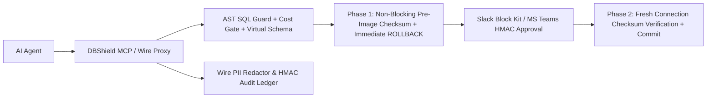

# 02 — DBShield Architecture

## Non-Blocking Two-Phase Pre-Image Checksum Coordinator
- **Phase 1 (Synchronous Inspection, `<5ms`)**: Computes a SHA-256 pre-image state checksum (`rowCount + latestTimestamp + schemaHash`), executes a detached dry-run with guaranteed immediate `ROLLBACK` (`0` held DB locks), and dispatches HMAC-signed Slack/MS Teams approval cards.
- **Phase 2 (Asynchronous Commit)**: Upon human approval, opens a fresh database connection, verifies the live pre-image checksum has not drifted (aborting with `PREIMAGE_DRIFT_DETECTED` on TOCTOU changes), and commits cleanly.
- **Zero Lock Contention**: Concurrent `SELECT` queries run unimpeded while destructive mutations wait in the human approval queue.
